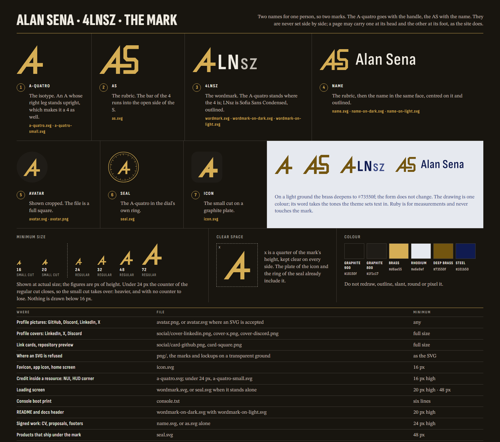

# The mark

Two names for one person, so two marks. The **A-quatro** goes with the
handle, `4LNsz`. The **AS** goes with the name, Alan Sena. They are never
set side by side; a page may carry one at its head and the other at its
foot, as the site does.



## Which file where

| Where | File | Minimum |
|---|---|---|
| Profile pictures: GitHub, Discord, LinkedIn, X | `avatar.png`, or `avatar.svg` where an SVG is accepted | any |
| Profile covers: LinkedIn, X, Discord | `social/cover-linkedin.png`, `cover-x.png`, `cover-discord.png` | full size |
| Link cards, repository preview | `social/card-github.png`, `card-square.png` | full size |
| Where an SVG is refused | `png/`, the marks and lockups on a transparent ground | as the SVG |
| Favicon, app icon, home screen | `icon.svg` | 16 px |
| Credit inside a resource: NUI, HUD corner | `a-quatro.svg`; under 24 px, `a-quatro-small.svg` | 16 px high |
| Loading screen | `wordmark.svg`, or `seal.svg` when it stands alone | 20 px high · 48 px |
| Console boot print | `console.txt` | six lines |
| README and docs header | `wordmark-on-dark.svg` with `wordmark-on-light.svg` | 20 px high |
| Signed work: CV, proposals, footers | `name.svg`, or `as.svg` alone | 24 px high |
| Products that ship under the mark | `seal.svg` | 48 px |

## The rules

- **One colour for the drawing.** Brass `#d6ae55` on graphite, deep
  brass `#73550f` on a light ground, or whatever the surface sets text
  in. The plate of the icon and the avatar is graphite `#1f1c17`.
  `a-quatro.svg`, `a-quatro-small.svg`, `as.svg`, `seal.svg`,
  `wordmark.svg` and `name.svg` draw in `currentColor`, so inline they
  take the colour of the text around them. As an `` they are black:
  use the `-on-dark` / `-on-light` files there, or `icon.svg`, which
  carries its own ground.
- **Ruby never touches the mark.** On the site it means "this is being
  measured", and a logo measures nothing.
- **Under 24 px, the small cut.** The counter of the regular A-quatro
  closes below that. Nothing is drawn below 16 px.
- **Clear space is a quarter of the mark's height**, on every side. The
  plate of the icon and the ring of the seal already include it.
- **Do not redraw, outline, slant, round or pixel it.** There is no
  8-bit version and there will not be one.

## With lettering

Two lockups set the mark beside a word, both in **Sofia Sans Condensed**,
the face the site uses for labels:

- **The wordmark, `4LNsz`.** The A-quatro stands where the 4 is, then
  `LN` in weight 700 and `sz` in 500, at 0.89 of the drawing's height
  (so the capitals reach about five eighths of it), tracked 0.05em. The
  letters sit a little above the drawing's feet; that is how the page
  header sets it, and the file matches the header to the hundredth.
- **The name.** The AS, then `Alan Sena` in weight 600 at 0.82 of its
  height, centred on it, tracked 0.02em.

In the files the letters are the font's own outlines, so nothing has to
be installed for them to look right. Each lockup comes three ways: one
colour (`wordmark.svg`, `name.svg`), and the site's two colourways
(`-on-dark`, `-on-light`), where the drawing is brass and the word takes
the tones the theme sets text in.

Do not substitute another face, and do not redraw the letters in the
mark's geometry. That was built once; it was a different logo.

## On a profile

`social/` holds two kinds of image, and they differ in one thing.

- **A cover** lies behind a profile. The platform lays the profile
  picture over its lower left corner and prints the name beside it, so
  a cover carries no mark (the picture is the mark), keeps its words
  clear of that corner, and lets the dial rise out of the opposite one.
  Each is the size its platform asks for: LinkedIn 1584×396, X 1500×500,
  Discord 1360×480, twice the 680×240 it asks for.
- **A card** stands alone, so it carries the wordmark, as the site's own
  link card does: `card-github.png` (1280×640) is a repository's social
  preview, `card-square.png` (1080×1080) is for a feed.

Upload them at the size they are. A cover scaled or cropped by hand
puts the name under the picture.

`png/` is for anything that will not take an SVG: the two drawings and
the two lockups, each for a dark and for a light ground, 800 px high
with nothing behind them. They are the vectors of the same name; the
one-colour drawings are brass in `-on-dark` and deep brass in
`-on-light`.

## In a README

An `` cannot inherit a colour, so a README needs both grounds and
lets the reader's theme pick:

```html
<picture>
  <source media="(prefers-color-scheme: dark)" srcset="brand/wordmark-on-dark.svg">
  
</picture>
```

## Rebuilding

Every vector here, and `public/favicon.svg`, is written by one script
from one description of the geometry. Edit the script, not the files:

```bash
node brand/src/build.mjs
```

It also writes `src/sheet.html` and prints the two drawings `index.html`
carries inline, the A-quatro in the header and the rubric in the footer,
to paste there if the drawing changes.

The lettering is a second, rarer step. `src/letters.mjs` reads the same
Sofia Sans Condensed files the site serves (from `node_modules`, so run
`npm ci` first), lays `LNsz` and `Alan Sena` out exactly as the page's
CSS does, and writes their outlines to `src/letters.json`, which
`build.mjs` reads. It checks its own result against the browser's layout
of the same words and fails if they disagree. Run it only if the
lettering changes:

```bash
node brand/src/letters.mjs
```

The face is licensed OFL-1.1, which permits converting it to outlines.

The rasters are captures of pages in `src/`, taken with any headless
browser at the size each page states in its own comment: `sheet.png`
from `src/sheet.html` (1680×1484), `avatar.png` from `avatar.svg`
(1024×1024), `public/og.png` from `src/og.html` (1200×630) and
`public/apple-touch-icon.png` from `src/touch-icon.html` (180×180).
Let the web fonts finish loading before capturing. There is no build
step for them.

The five images in `social/` come from one page, `src/social.html`,
opened with `?f=linkedin`, `x`, `discord`, `github` or `square` and
captured at the size its table gives for that name. Adding `&guide=1`
draws where the platform lays the profile picture, to check a change
against; do not capture with it on. The files in `png/` are the vectors
themselves, each opened at eight times its size and captured with no
page ground.
